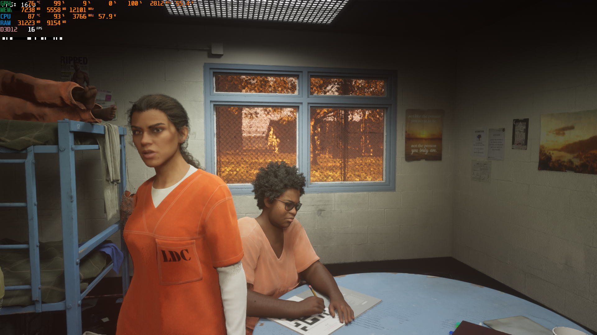
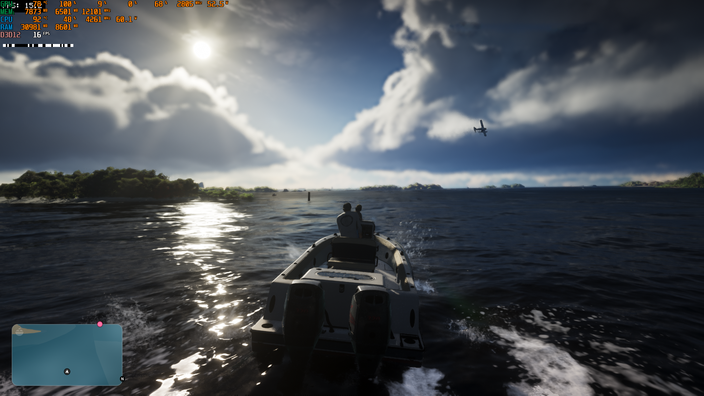

# WelcomeToFlorida

在 Windows x64 上用 Kelvaroq CLI 运行 Xbox Series 游戏。当前 NVIDIA 实机验证使用 VIctory-NVIDIA 后端和 Series S 配置，仓库也提供基于 cool_fox 的启动方式。

## 构建和启动

准备 Windows 10 或 11 x64、支持 AVX2 的 CPU、支持 Shader Model 6.6 和 Mesh Shader 的 Direct3D 12 GPU，以及包含 `game_scarlett_master.exe` 的完整本地游戏目录。构建需要 Rustup、MSVC C++ 构建工具、Windows SDK、Python 3 和 .NET Framework 4.8。

### VIctory-NVIDIA（Series S 与 DLSS）

在仓库根目录打开 PowerShell。构建后用附带的脚本从 NVIDIA 获取已验证的 Streamline `2.14.16`，最后将示例路径替换成自己的游戏目录。

```powershell
.\Build-SeriesS-DLSS.ps1
.\victory-nvidia\scripts\get-nvidia-sdks.ps1 -To "$env:LOCALAPPDATA\WelcomeToFlorida\nvidia\sdk"
.\Play-SeriesS-DLSS.ps1 -GameDirectory 'D:\Games\My Xbox Game'
```

已有 Streamline 时，用 `-StreamlineDirectory` 指定包含 DLL 的目录。NVIDIA 配置默认将存档与缓存写入 `%LOCALAPPDATA%\WelcomeToFlorida\nvidia` 下的 `data` 和 `cache`。也可用 `-DataDirectory` 和 `-CacheDirectory` 指定仓库外的路径。

### cool_fox

在仓库根目录打开 PowerShell，按顺序构建后端和 CLI，再将后端放到 CLI 的 `native` 目录。

```powershell
Push-Location .\cool_fox
cargo build --locked --profile diag -p victory --features diagnostics
Pop-Location

cargo +1.98.1 build --locked --release --bin kelvaroq --manifest-path .\kelvaroq\Cargo.toml
$cliDir = Join-Path $PWD 'kelvaroq\target\release'
$nativeDir = Join-Path $cliDir 'native'
New-Item -ItemType Directory -Path $nativeDir -Force | Out-Null
Copy-Item -LiteralPath '.\cool_fox\target\diag\victory.exe' -Destination (Join-Path $nativeDir 'kelvaroq-engine.exe')
```

将下面的示例路径替换成自己的游戏目录。

```powershell
.\Play-3D.cmd 'D:\Games\My Xbox Game'
```

已有装入 cool_fox 后端的 Kelvaroq 便携包时，也可传入该目录。目录中应有 `kelvaroq-cli.exe` 和 `native\kelvaroq-engine.exe`。

```powershell
.\Play-3D.cmd 'D:\Games\My Xbox Game' 'D:\Tools\Kelvaroq-Florida'
```

默认存档路径为 `%LOCALAPPDATA%\WelcomeToFlorida\data`，着色器缓存路径为 `%LOCALAPPDATA%\WelcomeToFlorida\cache`。启动前设置 `VICTORY_DATA_DIR` 或 `VICTORY_CACHE_DIR` 可复用已有的本地目录。首次运行需要生成着色器缓存。

#### 复现早期实机配置

按上文构建并安装后端后，从仓库根目录运行以下命令。脚本默认运行本仓库构建的 Kelvaroq 和 cool_fox，游戏路径默认指向同级的游戏目录。本机有 `20261127-133203-series-s-full-textures` 验证目录时，脚本复用其中的缓存和存档。启动后手动进入游戏。

```powershell
.\Play-3D-Validated.ps1
```

用 `-GameDirectory` 指定其他游戏目录。复现历史构建时，另用 `-ValidationDirectory` 指定包含 `portable`、`cache`、`data` 的验证目录。该选项会运行目录内的便携后端。

```powershell
.\Play-3D-Validated.ps1 -GameDirectory 'D:\Games\My Xbox Game' -ValidationDirectory 'D:\Runs\series-s-full-textures'
```

## 渲染验证

2026 年 11 月 28 日，在 RTX 5060 Laptop（8 GB 显存、驱动 `621.01`）上验证 VIctory-NVIDIA 后端。Series S 以 1280×720 渲染，用 DLSS Quality 输出 1920×1080，关闭帧生成。实机已通过序章首个检查点，并拍到了「去钓鱼」任务的乘船段。

| 指标 | 实机记录 |
| --- | --- |
| 帧率 | 观察峰值约 **25 FPS**，序章片段平均约 **15–20 FPS**。帧率随场景变化，固定路线仍待复测。 |
| 整卡显存占用 | 峰值约 **8 GB**（纹理预算试验为 7.64 GiB），短程对照平均约 **5 GB**（5.47 GiB）。跑至首个检查点的一轮平均为 6.59 GiB。 |

当前配置关闭 BVH 构建，依赖 BVH 的光追通道会被跳过。部分阴影偏暗，材质细节仍在验证。

手机过场的彩色色带出现在 10 位调色通道。当前后端对两份受影响的像素着色器使用显式三线性插值，RTX 5060 Laptop 实机复测已通过手机近景。[调色验证记录](docs/series-s-rendering-plan.md#调色色带)

### NVIDIA 实机截图





### 早期 cool_fox 截图

2026 年 11 月 27 日，cool_fox 在同一台电脑上以 Series S 配置运行。启用实验性的 Wave64 配对转译、关闭按需 mip 驻留和 BVH 构建后，暖缓存运行约 54 秒显示序章 3D，帧率约 1–2 FPS。


[下载 5 张原始 PNG 截图（ZIP，约 4.6 MiB）](docs/screenshots/series-s-prologue.zip?raw=true)

## 源码与历史

| 路径 | 用途与版本 |
| --- | --- |
| [`kelvaroq/`](kelvaroq/) | Kelvaroq 启动器和参考实现，来自 [v0.2.0](https://github.com/fablinoo/kelvaroq/tree/v0.2.0)（`0a3c30d`）。 |
| [`cool_fox/`](cool_fox/) | 实测用的 VIctory 分支与原生渲染后端，版本 `f4b48ad`。该提交和父提交来自 [cool-fox-codec 镜像](https://github.com/ComputerScape04/cool-fox-codec/tree/f4b48ad766ddbec1a1867022cd42f7645b0dd55e)，源码树已与实测副本核对。 |
| [`victory-nvidia/`](victory-nvidia/) | 当前 NVIDIA 验证使用的渲染后端，基于 [VIctory-NVIDIA](https://github.com/trustno1-coder/VIctory-NVIDIA) 的 `d12eb1b2`。 |
| [原有兼容性探针](docs/legacy-probe.md) | 本仓库中的 Scarlett 调试与启动实验记录。 |

导入的源码保留了上游提交及其祖先。可以用 `git log kelvaroq-v0.2.0`、`git log pareto-residency-37a410b1` 或 `git log d12eb1b2` 查看相应历史。根目录的旧探针提交也保留在 `main`。

## 许可证

根目录的 [LICENSE](LICENSE) 将自有兼容性探针和文档置于 Unlicense 下，[LICENSE-NOTICES.md](LICENSE-NOTICES.md) 说明各导入组件的授权边界。Kelvaroq 主体、VIctory-NVIDIA、cool_fox 和改编自 cool_fox 的 Play-3D.cmd 适用 GPL-3.0-or-later。[Kelvaroq 的研究模块](kelvaroq/research/LICENSE) 适用 GPL-2.0-or-later。

分发 GPL 组件的二进制时，请按对应版本的 GPL 提供完整对应源码，并保留许可证和版权声明。Kelvaroq 的名称和标识另有[上游说明](kelvaroq/README.md#name-and-logo)。

Microsoft DirectStorage SDK 适用 [随附条款和声明](vendor/directstorage-1.3.0/README.md)。BCPack 常量表的权利说明见 [cool_fox 的资产政策](cool_fox/docs/asset-policy.md#the-one-exception)。截图中游戏画面的权利归相应权利人，具体范围见 [许可证说明](LICENSE-NOTICES.md#组件范围)。
