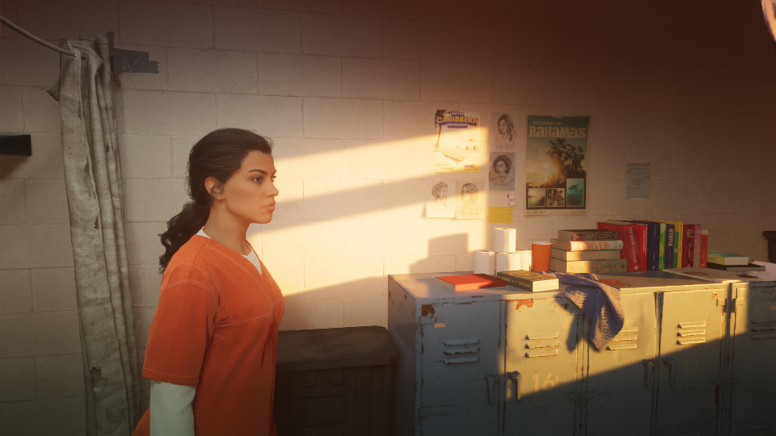
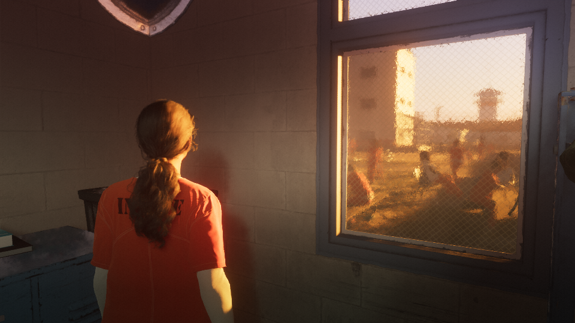

# WelcomeToFlorida

在 Windows x64 上用 Kelvaroq CLI 和 cool_fox 渲染后端运行 Xbox Series 游戏。`Play-3D.cmd` 以 Series S 配置启动，并应用 cool_fox 的 `pareto-residency` 渲染参数。

## 构建和启动

准备 Windows 10 或 11 x64、支持 AVX2 的 CPU、支持 Shader Model 6.6 和 Mesh Shader 的 Direct3D 12 GPU，以及包含 `game_scarlett_master.exe` 的完整本地游戏目录。构建需要 Rustup、MSVC C++ 构建工具、Windows SDK、Python 3 和 .NET Framework 4.8。

在仓库根目录打开 PowerShell，按顺序构建后端和 CLI，再将后端放到 CLI 的 `native` 目录。

```powershell
Push-Location .\cool_fox
cargo build --locked --profile diag -p victory --features diagnostics
Pop-Location

cargo +1.98.1 build --locked --release --bin kelvaroq --manifest-path .\kelvaroq\Cargo.toml
$cliDir = Join-Path $PWD 'kelvaroq\target\release'
$nativeDir = Join-Path $cliDir 'native'
New-Item -ItemType Directory -Path $nativeDir -Force | Out-Null
Copy-Item -LiteralPath '.\cool_fox\target\diag\victory.exe' -Destination (Join-Path $nativeDir 'kelvaroq-engine.exe')
```

将下面的示例路径替换成自己的游戏目录。

```powershell
.\Play-3D.cmd 'D:\Games\My Xbox Game'
```

已有装入 cool_fox 后端的 Kelvaroq 便携包时，也可传入该目录。目录中应有 `kelvaroq-cli.exe` 和 `native\kelvaroq-engine.exe`。

```powershell
.\Play-3D.cmd 'D:\Games\My Xbox Game' 'D:\Tools\Kelvaroq-Florida'
```

默认存档路径为 `%LOCALAPPDATA%\WelcomeToFlorida\data`，着色器缓存路径为 `%LOCALAPPDATA%\WelcomeToFlorida\cache`。启动前设置 `VICTORY_DATA_DIR` 或 `VICTORY_CACHE_DIR` 可复用已有的本地目录。首次运行需要生成着色器缓存。

### 复现实机验证配置

当仓库、游戏目录和 `Florida-render-validation` 位于同一级目录时，从仓库根目录运行以下命令。脚本默认复用 `20261127-133203-series-s-full-textures` 下的 `portable`、`cache` 和 `data`，启动后手动进入游戏。

```powershell
.\Play-3D-Validated.ps1
```

也可以指定游戏目录和包含 `portable`、`cache`、`data` 的验证目录。

```powershell
.\Play-3D-Validated.ps1 -GameDirectory 'D:\Games\My Xbox Game' -ValidationDirectory 'D:\Runs\series-s-full-textures'
```

## 渲染验证

2026 年 11 月 27 日，在 RTX 5060 Laptop（8 GB 显存、驱动 `621.01`）上以 Series S 配置测试。启用实验性的 Wave64 配对转译、关闭按需 mip 驻留和 BVH 构建后，暖缓存运行约 54 秒显示序章 3D 场景，并继续渲染人物近景、监舍、窗外景物和走廊。下列截图来自这次运行。帧率约 1–2 FPS，个别镜头仍有光照和材质异常。





[下载 5 张原始 PNG 截图（ZIP，约 4.6 MiB）](docs/screenshots/series-s-prologue.zip?raw=true)

## 源码与历史

| 路径 | 用途与版本 |
| --- | --- |
| [`kelvaroq/`](kelvaroq/) | Kelvaroq 启动器和参考实现，来自 [v0.2.0](https://github.com/fablinoo/kelvaroq/tree/v0.2.0)（`0a3c30d`）。 |
| [`cool_fox/`](cool_fox/) | 实测用的 VIctory 分支与原生渲染后端，版本 `f4b48ad`。该提交和父提交来自 [cool-fox-codec 镜像](https://github.com/ComputerScape04/cool-fox-codec/tree/f4b48ad766ddbec1a1867022cd42f7645b0dd55e)，源码树已与实测副本核对。 |
| [原有兼容性探针](docs/legacy-probe.md) | 本仓库中的 Scarlett 调试与启动实验记录。 |

两套源码均保留了提交及其祖先。可以从仓库根目录用 `git log kelvaroq-v0.2.0` 或 `git log pareto-residency-37a410b1` 查看相应历史。根目录的旧探针提交继续保留在 `main`。

## 许可证

根目录的 [LICENSE](LICENSE) 将自有兼容性探针和文档置于 Unlicense 下，[LICENSE-NOTICES.md](LICENSE-NOTICES.md) 说明各导入组件的授权边界。Kelvaroq 主体、cool_fox 和改编自 cool_fox 的 Play-3D.cmd 适用 GPL-3.0-or-later。[Kelvaroq 的研究模块](kelvaroq/research/LICENSE) 适用 GPL-2.0-or-later。

分发 GPL 组件的二进制时，请按对应版本的 GPL 提供完整对应源码，并保留许可证和版权声明。Kelvaroq 的名称和标识另有[上游说明](kelvaroq/README.md#name-and-logo)。

Microsoft DirectStorage SDK 适用 [随附条款和声明](vendor/directstorage-1.3.0/README.md)。BCPack 常量表的权利说明见 [cool_fox 的资产政策](cool_fox/docs/asset-policy.md#the-one-exception)。截图中游戏画面的权利归相应权利人，具体范围见 [许可证说明](LICENSE-NOTICES.md#组件范围)。
